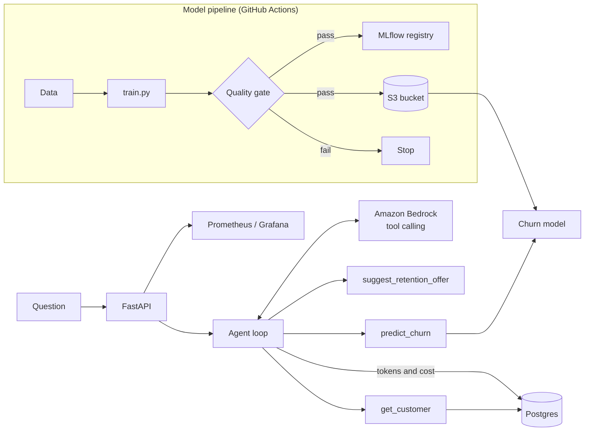

# Customer Retention AI – Churn Model + LLM Assistant on AWS

A learning project to practise the full MLOps lifecycle on top of my DevOps / platform engineering background.

For the last few months I have been building infrastructure for our ML team at work (GPU compute, S3 storage, Terraform). In this project I wanted to go end to end myself: train a simple model, track it with MLflow, serve it with FastAPI, add an LLM assistant on Amazon Bedrock that uses the model through tool calling, and run it with the infrastructure and CI/CD I already use day to day.

The use case: a telecom company wants to know which customers are likely to leave (churn) and what to offer them.

```
POST /assistant/ask  {"question": "Will customer C0014 leave? What should we offer?"}

"Customer C0014 has a 94% chance of leaving (high priority). Main reasons: the customer is on a
 month-to-month contract, has made 3 support calls, joined only 1 month ago, pays a high monthly
 bill (103.0). Suggested action: 20% discount for 6 months if they move to a one-year contract."
```

## Architecture



## What is in the project

| Part | What I built | Tools |
|---|---|---|
| ML model | Logistic regression churn model with train/test split and accuracy, F1, ROC-AUC | Python, pandas, scikit-learn |
| Experiment tracking | Each training run logged; passing models registered as new versions | MLflow |
| Quality gate | Training fails (exit code 1) if accuracy < 0.70 or ROC-AUC < 0.75, which stops the pipeline | Python, GitHub Actions |
| Model API | `/predict`, `/health`, `/metrics` | FastAPI, Pydantic |
| LLM assistant | `/assistant/ask`: the LLM calls 3 tools and explains the result in plain English | Amazon Bedrock Converse API |
| Usage tracking | Tokens, cost and latency of every LLM call stored in Postgres; `/assistant/usage` | Postgres, SQLAlchemy, SQL |
| Infrastructure | S3 bucket for models, ECR, IAM roles (IRSA with S3 read + Bedrock access), optional GPU instance | Terraform |
| Deployment | Helm chart with ConfigMap, Secret, HPA, probes | Docker, Helm, Amazon EKS |
| CI/CD | Terraform/Helm checks → tests → train with quality gate → Docker build → smoke test | GitHub Actions |
| Operations | Prometheus metrics (requests, latency, tokens, cost) and a runbook | Prometheus, Grafana |

## How the LLM assistant works

1. The question is sent to the LLM with a system prompt and three tool definitions.
2. The LLM asks for a tool, for example `get_customer {"customer_id": "C0014"}`.
3. My code runs the tool and sends the result back. The same happens for `predict_churn` and `suggest_retention_offer`.
4. The LLM writes the final answer using only the tool results.
5. Each LLM call's tokens, cost and latency are saved in Postgres.

Simple safety limits: maximum 5 LLM steps per question, 500-character question limit, output token limit, temperature 0. The churn probability always comes from the ML model and the offer from fixed rules, not from the LLM.

`LLM_PROVIDER=mock` (default) uses a small stand-in that follows the same Bedrock message format, so tests and CI run without AWS. `LLM_PROVIDER=bedrock` uses the real model.

## Project structure

```
churn-mlops/
├── data/generate_data.py      # synthetic customer data
├── src/
│   ├── train.py               # training + MLflow + quality gate
│   ├── app.py                 # FastAPI
│   ├── config.py, s3_utils.py
│   └── assistant/
│       ├── agent.py           # agent loop, token and cost calculation
│       ├── llm.py             # Bedrock client + mock
│       ├── tools.py           # the 3 tools
│       └── db.py              # Postgres tables
├── sql/usage_queries.sql      # cost, errors, failed conversations
├── docs/RUNBOOK.md
├── terraform/                 # S3, ECR, IAM, optional GPU instance
├── helm/churn-api/            # Helm chart
├── tests/                     # 17 tests
├── .github/workflows/ml-pipeline.yml
├── Dockerfile, docker-compose.yml, Makefile
└── requirements.txt, requirements-serve.txt
```

## How to run

### Local (no AWS needed)

```bash
python -m venv .venv && source .venv/bin/activate     # Windows: .venv\Scripts\activate
pip install -r requirements.txt

python data/generate_data.py
python -m src.train                    # run 1
python -m src.train --C 0.01           # run 2, to compare in MLflow
python -m pytest -v
mlflow ui --backend-store-uri sqlite:///mlflow.db      # http://localhost:5000
uvicorn src.app:app --port 8000                        # http://localhost:8000/docs
```

In Swagger, try `POST /assistant/ask` with "Will customer C0014 leave? What should we offer?" (customers C0001–C0050 are loaded automatically), then `GET /assistant/usage`.

### With Postgres and monitoring

```bash
python -m src.train
docker compose up --build -d
```

API on port 8000, Postgres on 5432, Prometheus on 9090, Grafana on 3000.

### With Amazon Bedrock

Enable model access in the Bedrock console, then:

```bash
export LLM_PROVIDER=bedrock
export BEDROCK_MODEL_ID=anthropic.claude-3-haiku-20240307-v1:0
export AWS_REGION=ap-south-1
uvicorn src.app:app --port 8000
```

Update `PRICE_INPUT_PER_1K` and `PRICE_OUTPUT_PER_1K` to the current Bedrock price for accurate cost figures.

### AWS infrastructure and EKS

```bash
cd terraform && cp terraform.tfvars.example terraform.tfvars
terraform init && terraform plan

# model to S3
export MODEL_S3_PREFIX=s3://$(terraform output -raw artifacts_bucket)/models
cd .. && python -m src.train

# deploy
kubectl create secret generic churn-api-db -n ml-serving \
  --from-literal=DATABASE_URL='postgresql+psycopg://<user>:<password>@<host>:5432/assistant'
helm upgrade --install churn helm/churn-api -n ml-serving --create-namespace \
  --set image.repository=<ecr-repo-url> --set image.tag=<git-sha> \
  --set serviceAccount.roleArn=<model-api-role-arn> \
  --set model.s3Uri=s3://<bucket>/models/latest/model.joblib \
  --set model.metricsS3Uri=s3://<bucket>/models/latest/metrics.json
```

## Results

| Run | Accuracy | F1 | ROC-AUC | Quality gate |
|---|---|---|---|---|
| C = 1.0 (default) | 0.791 | 0.609 | 0.832 | Passed |
| C = 0.01 | 0.778 | 0.536 | 0.834 | Passed |

I kept C = 1.0 because its F1 is clearly better, and F1 matters here since only about 30% of customers churn.

Assistant: 4 LLM calls per question (3 tool calls + final answer). Tested with the mock provider and with Postgres 16.

## What I learned

- The ML lifecycle is mostly the same as a normal delivery pipeline, plus two extra things to version and test: the data and the model.
- Saving preprocessing and the model together in one scikit-learn pipeline avoids differences between training and serving.
- With LLMs, tokens are the cost driver, so usage has to be measured per call from day one.
- Letting the LLM decide *which* tool to call, but never letting it invent numbers, makes the answers easier to trust and debug.
- My existing skills (Terraform, IAM/IRSA, EKS, CI/CD, monitoring, runbooks) carry over directly to running ML and LLM workloads.

## Limitations and next steps

- Data is synthetic; next I want to try the public Telco Customer Churn dataset.
- The mock LLM is only for tests; answer quality needs to be checked on the real Bedrock model.
- Not yet covered: monitoring for data drift, Amazon SageMaker, RAG, and LangGraph. These are what I am learning next.
